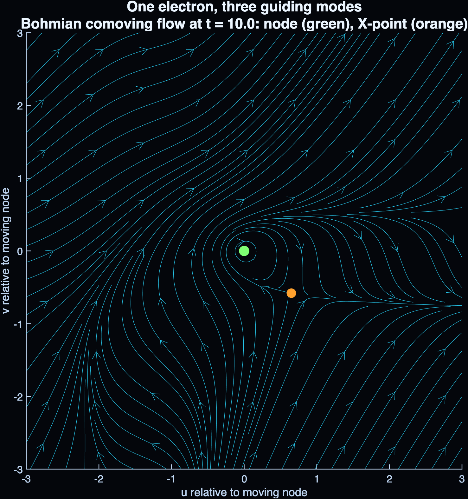

# Invariant-channel bridge

## Established common structure

The measured channel has a finite return operator with a complex rotating pair,
an axial real mode, sixteen alternating Poincare crossings, and a characteristic
polynomial close to reciprocal form. `Riemann/Bridge.lean` proves that the
Cayley transform `s / (1 - s)` lies on the unit circle exactly when `s` lies on
the critical line, and checks the channel polynomial's reciprocal defects.

The Alpoge-Claude archive independently contains finite-dimensional recurrence
polynomials, recurrence-growth bounds on their roots, nonnegative flows on
cyclic sites, dual capacity bounds, and positive-semidefinite spectral
operators. Its formally checked endpoint is Mathlib's classical
`RiemannHypothesis` statement. Relevant declarations include:

- [`exists_recurrence_polynomial`](https://github.com/CocoSgt/riemann-hypothesis-lean/blob/main/src/Development/AutomorphicSpectrum/Proofs/BlockDecomposition/ExistsRecurrencePolynomialStatement.lean)
- [`norm_le_of_recurrence_growth'`](https://github.com/CocoSgt/riemann-hypothesis-lean/blob/main/src/Development/AbelianVarietyTheory/Proofs/SatakeParameters/NormLeOfRecurrenceGrowthStatement.lean)
- [`IsFlow`](https://github.com/CocoSgt/riemann-hypothesis-lean/blob/main/src/Formalism/IncomingBounds/IncomingBound.lean)

The Lean and Mathlib communities have independently checked its statement and
proof export: <https://leanprover-community.github.io/blog/posts/riemann-hypothesis/>.

Masullo's *The Music of the Primes* supplies the closest geometric language.
It constructs an `R_{>0}` action, periodic orbits and fixed points, Mellin
transforms, orbital kernels, and a proposed trace formula relating a geometric
side to a zero-bearing spectral side. The released draft is architectural
evidence rather than a completed checked proof: its final deduction from the
trace formula to the zero statement remains unfinished.

Original draft: <https://math216.wordpress.com/wp-content/uploads/2026/11/the-music-of-the-primes.pdf>.
Its open Lean formalization reports roughly 690 remaining `sorry`s, has not
reached the trace formula, and correctly rejects its headline comparator while
`sorryAx` remains: <https://github.com/mccorvie/riemann-masullo>.

## Geometric specificity

Reciprocal structure was tested across deterministic windows rather than
assumed special. At the original 594-transition scale, only path 22 is long
enough for comparison; its formal channel is in the best 9.09% of its 22
windows. At the fair 200-transition scale, 190 windows from 31 paths are
available. Riemann's first certified return arc ranks in the best 3.16%; path
22 supplies 16 of the 20 most reciprocal windows, and its median defect is
about eleven times smaller than the median for all other paths.

The structure is therefore concentrated along the broader return corridor. It
is neither unique to one selected interval nor generic to every streamline.
The complete tables are `data/bridge_reciprocal_specificity.tsv` and
`data/bridge_return_specificity.tsv`.

## Rejected direct bridge

The parameter-free identification

```text
rho = lambda / (1 + lambda)
```

was tested once using the measured complex channel eigenvalue. It gives
`rho = 0.50008422535013541 + 0.020916639217677918 i`, where
`|zeta(rho)| = 1.4594888860831998`. The direct eigenvalue-to-zero map is false
for this operator. The frozen receipt is `data/channel_cayley_test.txt`.

## Electron pilot-wave candidate

The most economical physical model is one electron guided by a superposition
of three wave modes. For a spinless charged particle,

```text
velocity = probability current / density = (gradient phase - charge * A) / mass.
```

This puts trajectory geometry, current, charge, phase, and electromagnetic
vector potential in one equation. It does not make the MATLAB wind field a
quantum field; it defines an inverse problem with observable failure criteria.

Efthymiopoulos, Kalapotharakos, and Contopoulos studied exactly one particle
guided by three stationary states. In a frame moving with a wavefunction node,
one invariant manifold of a nearby saddle X-point continues as a spiral
terminating at the node. Their model also exhibits a limit circle that reaches
the separatrix and disappears:
<https://arxiv.org/abs/0709.2038>.

`source/explore_bohmian_electron_bridge.m` independently reproduces one frozen
snapshot of their published model at `t = 10`. It finds one X-point at relative
coordinate `(0.6481555180, -0.5782290170)`, distance `0.8685933293` from the
moving node, with saddle eigenvalues approximately `0.715424` and `-2.490441`.



The structural correspondence to test is:

```text
nearest saddle zero       -> X-point candidate
stable/unstable whiskers  -> invariant manifolds
recurrent spiral channel  -> guided electron trajectory
unreconstructed psi zero  -> moving nodal line
```

A field stagnation point is not a wavefunction node. The next physical test is
to determine whether a positive density, phase, and vector potential can make
the measured field a Bohmian velocity while satisfying the continuity and
Schrodinger equations. Failure of that inverse problem rejects the physical
identification while leaving the geometric return result unchanged.

## Surviving bridge theorem

The common structure is operator-level:

```text
channel return operator --J--> arithmetic convolution/trace operator
```

The required map `J` must preserve scalar action and intertwine the two
operators. `Riemann/Bridge.lean` proves that any such map carries an
eigen-relation from the channel operator to the arithmetic operator.

Constructing `J` is open. A natural candidate begins with the Mellin transform
of a return observable because the channel supplies rotation and radial scaling,
while Masullo's arithmetic flow is multiplicative and Mellin-diagonalized. A
valid construction must determine its normalization before consulting zeta and
must predict held-out trace or zero data without retuning.
