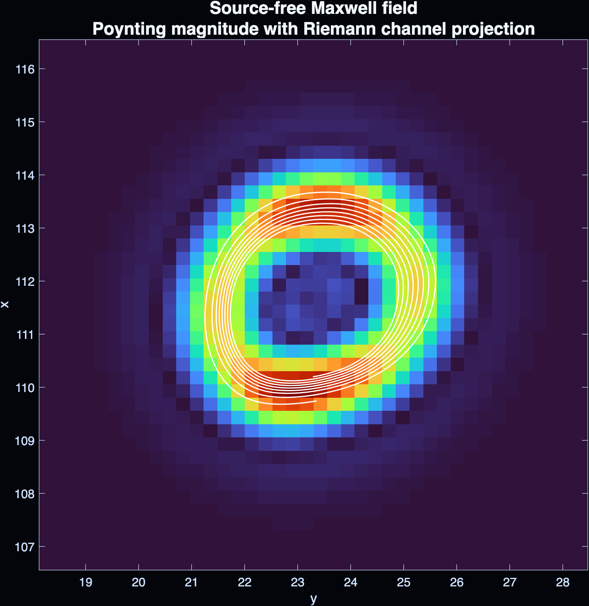

# Photon compatibility test

## Accepted result

Four measured neighboring streamlines (`511`, `512`, `545`, and `544`) define
a clock-free transverse bundle around Riemann. Their fourteen positive crossings
of the same Poincare plane show:

- maximum Poynting-flux density multiplier: `57.653219877708224`;
- minimum projected bundle area: `4.079445403704085e-08`;
- three signed-area reversals, marking folds through caustics;
- subsequent re-expansion rather than irreversible collapse.

At every crossing, a local null electromagnetic field was constructed with
positive energy density, perpendicular equal-magnitude `E` and `B`, and
`E cross B = u n`. The maximum numerical residual is
`1.4273599921707572e-14`.

This establishes local Poynting-flow compatibility and finite focusing. It does
not establish a global source-free Maxwell solution or a one-photon quantum
state.

## Rejected reconstructions

The full 3D variational determinant implied a `131.06` density multiplier, but
that is phase-volume contraction rather than transverse photon-flux focusing.

A transverse reconstruction from the saved-sample tangent cocycle was rejected
because its autonomy residual is `0.91493`. Its derived `182.51` multiplier is
not admissible.

A fresh unit-speed arclength integration satisfies its internal tangent and
Liouville checks, but misses the stored endpoint by `3.03762` units. Its derived
`17.59` multiplier is likewise not admitted as a measurement of Riemann.

## Boundary

The accepted bundle result uses only recorded neighboring trajectories and a
single crossing plane, so it does not need a photon clock. A global Maxwell
construction additionally requires polarization, phase, and boundary choices;
the canonical choices below are explicit test inputs rather than quantities
inferred from the MATLAB wind geometry.

## Global source-free Maxwell construction

A canonical test field was built in a `40^3` periodic vacuum box using one
fixed transverse-polarization rule. Both fields were projected onto the
divergence-free Fourier subspace and evolved with the exact source-free Maxwell
mode solution. No charge or current density is present.

- electric Gauss residual after evolution: `1.0069e-16`;
- magnetic Gauss residual after evolution: `9.8863e-17`;
- relative energy residual: `3.8208e-15`;
- initial weighted Poynting alignment with Riemann: `0.998660`;
- alignment after evolution time `0.2`: `0.918293`;
- forward-aligned tube fraction: `1.0` at both measured times.

This establishes existence of a global source-free classical Maxwell field
whose Poynting flow approximates the channel and remains aligned under finite
evolution. It is one construction, not a unique inverse and not by itself a
proof of a normalized one-photon quantum state.

Primary references for photon energy-flow trajectories:

- <https://arxiv.org/abs/quant-ph/0102071>
- <https://doi.org/10.1088/1367-2630/15/7/073022>
- <https://doi.org/10.1103/PhysRevLett.93.090402>
