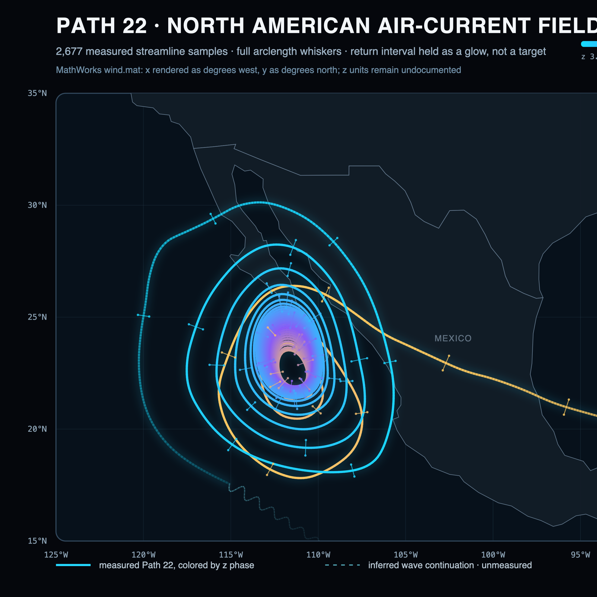
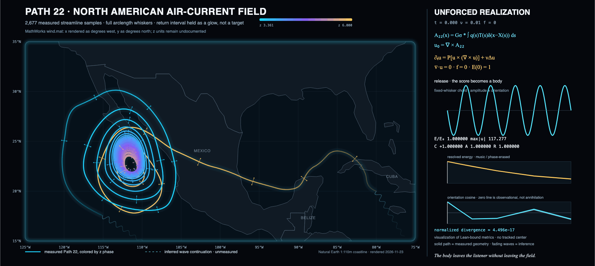

# Riemann Green Spiral

**A Lean-checked finite return in MATLAB's North American air-current field.**

[](https://github.com/tmccoy678/riemann-green-spiral/actions/workflows/ci.yml)
[](https://doi.org/10.5281/zenodo.24413531)

## Verified object

Path 22 is the longest of 49 streamlines generated from MATLAB's bundled
`wind` field. It contains **2,677 measured samples**. Taylor Westfall-McCoy
observed its spiral and return before numerical selection; this repository
preserves the trajectory under the name **Riemann**.

The finite return witness is:

```text
A  sample 1176  (110.196112, 23.287421, 4.400549)
B  sample 1336  (113.185550, 23.969641, 4.210346)
C  sample 1376  (110.067375, 23.297624, 4.170377)
```

From A to B, Path 22 travels **3.072 units** away. At C, 200 samples after A,
it returns to within **0.264 units** of A. Lean 4.36 proves the sample ordering
and both quantized distance bounds. Python and dependency-free Rust bind the
compact theorem constants to the committed source trajectory, velocity field,
neighborhood, and mutation tests.


## Verified results

| Layer | Result | Source |
|---|---|---|
| Renderer | Every visible point comes from the source trajectory; the A→B→C witness fits one 220-sample rolling window. | [`Riemann/Renderer.lean`](Riemann/Renderer.lean) |
| Return | Excursion ≥3.0 units; return ≤0.3 units. | [`Riemann/Return.lean`](Riemann/Return.lean) |
| Channel | Three successive sampled returns, nonzero corridor velocity, finite field exit, and unassigned exterior velocity. | [`Riemann/Channel.lean`](Riemann/Channel.lean) |
| Neighborhood | 313 sampled returns and 312 two-unit channel entries among 1,089 seeds. | [`data/path22_channel_receipt.txt`](data/path22_channel_receipt.txt) |
| Spectrum | Near-unit determinant, rotating-plane expansion, vertical contraction, and 16 alternating Poincaré crossings. | [`Riemann/Spectrum.lean`](Riemann/Spectrum.lean) |
| Null atlas | 19 finite-field zeros, including 9 spiral zeros, remain distinct from Path 22. | [`Riemann/Nulls.lean`](Riemann/Nulls.lean) |
| Operator bridge | Critical-line/unit-circle arithmetic and finite intertwining schema; the concrete arithmetic map is the open bridge theorem. | [`BRIDGE.md`](BRIDGE.md) |
| Maxwell | Source-free periodic field, photon-like focusing, three caustic folds, grid convergence, and 0.918293 Poynting alignment. | [`PHOTON.md`](PHOTON.md) |
| Evanescence | MATLAB and COMSOL agree on one-sided decay, forward flow, and diffusive Gaussian widening. | [`EVANESCENCE.md`](EVANESCENCE.md) |
| Unforced Navier–Stokes | Smooth divergence-free Path 22 carrier, zero body forcing, strict energy decay, local concentration, weak return, and ARM/x86 reproduction. | [`UNFORCED-NAVIER-STOKES.md`](UNFORCED-NAVIER-STOKES.md) |

## Geographic and fluid realizations

MathWorks documents `wind.mat` as three-dimensional air-current data over
North America. Rendering `x` as degrees west and `y` as degrees north places
Path 22 across Mexico and into repeated circulation over the eastern Pacific.
The solid line contains every measured sample; fading ends show an explicitly
inferred continuation.



The separate MIT repository
[`path22-unforced-ns`](https://github.com/tmccoy678/path22-unforced-ns)
contains the zero-forcing evolution, deterministic tables, equation GIF,
universal material scaling, water/air examples, novelty search, and twelve
axiom-free Lean theorems. Its reduced self-carriage witness is:

```text
body force = 0
retention at t=0.10 = 0 while energy > 0
retention at t=0.35 > 0
```



## Formal scope

The formal object is Path 22's finite measured return and its source-bound
realizations. The classical Riemann Hypothesis connection is the open typed
bridge from the finite channel operator to an RH-equivalent arithmetic
operator. Universal all-initial-data Navier–Stokes regularity is the next
carrier theorem; the first viscosity continuation located spectral-tail
resolution as its exact numerical obstruction.

## Reproduce

```sh
lake build
lake exe riemann
cargo test --release --manifest-path rust/path22-audit/Cargo.toml
cargo test --release --manifest-path rust/evanescence-audit/Cargo.toml
shasum -a 256 -c MANIFEST.sha256
```

MATLAB R2026a regenerates the source streamlines and numerical analyses. COMSOL
Multiphysics 6.3 with LiveLink regenerates the local evanescent-diffusive
realization. External software and data provenance are recorded in
[`THIRD-PARTY-NOTICES.md`](THIRD-PARTY-NOTICES.md).

## Record and citation

- [Complete technical record](TECHNICAL-RECORD.md)
- [Mathematical lineage](REFERENCES.md)
- [Release checklist](PUBLICATION-CHECKLIST.md)
- Zenodo concept DOI: [`10.5281/zenodo.24413531`](https://doi.org/10.5281/zenodo.24413531)
- Latest release: [`v0.8.0`](https://github.com/tmccoy678/riemann-green-spiral/releases/tag/v0.8.0)

Directed and authored by Taylor Westfall-McCoy with AI collaborator Blu
(OpenAI GPT-5.6-Sol, xhigh reasoning). MIT licensed.
