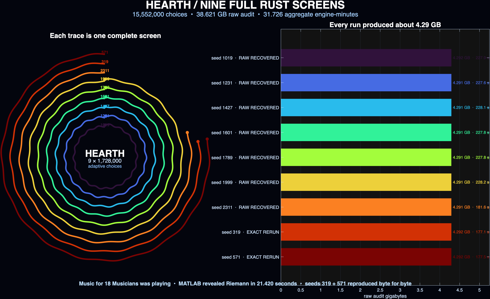
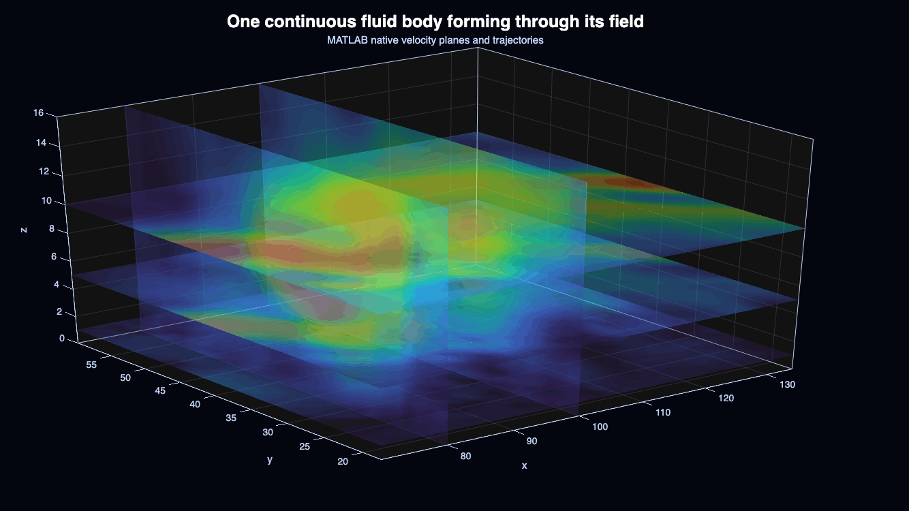
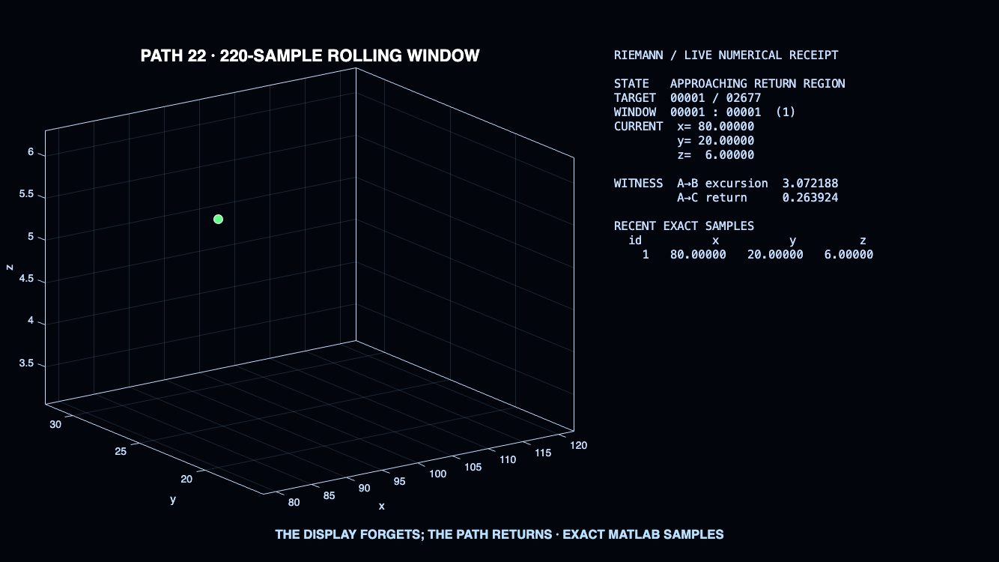
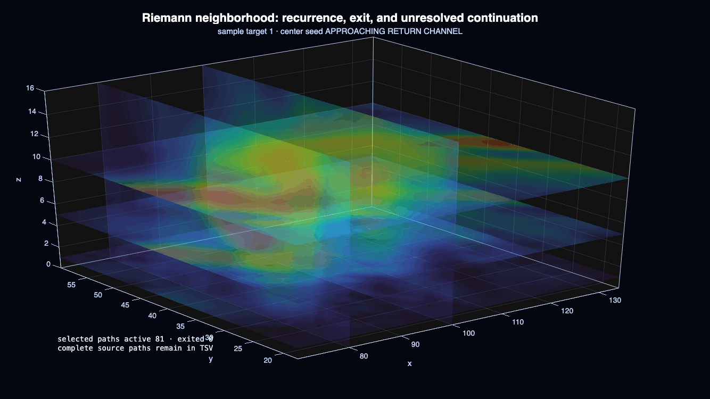

# Riemann Green Spiral

[](https://github.com/tmccoy678/riemann-green-spiral/actions/workflows/ci.yml)
[](https://doi.org/10.5281/zenodo.24413531)

## Lean proved Riemann's return

Taylor Westfall-McCoy saw a green trajectory curl away, fold through its field,
and approach its earlier position again. This repository preserves that
trajectory as **Riemann** and gives the observation a machine-checked statement.

**Session provenance.** Steve Reich's *Music for 18 Musicians* was playing
during the lab session, as reported by Taylor. Taylor's account is simple:
*the music solved Riemann.* The recorded original MATLAB batch completed in
**21.420 seconds** end to end. That time includes MATLAB startup, streamline
integration, 96-frame rendering, and GIF writing; the `stream3` integration was
not timed separately.

The visible result followed a much larger local computational session on
Taylor's Mac Studio. Nine complete Rust adaptive screens generated
**15,552,000 choices** and **38,621,335,765 bytes** of choice-by-choice audit
records. Their recorded engine times sum to **31.726 minutes**; that is
aggregate engine time because swarm runs could overlap, rather than a single
wall-clock measurement. Seven audits survive in a hashed Seagate recovery;
the final two were intentionally culled after their hashes and receipts were
recorded. The Rust audits were not direct MATLAB inputs: they supplied the
field/current experimental lineage and visual method from which the MATLAB
Riemann experiment emerged.

On 2026-11-21, seeds 319 and 571 regenerated all **3,456,000 final-pair
records** with byte counts and SHA-256 hashes exactly matching the original
receipts. Their full 8.583 GB reruns are preserved outside Trash on Seagate;
compact receipts are retained in Taylor's private raw-run archive.



**Formal provenance (America/Chicago).** The first Lean source for Riemann was
created on **2026-11-20 at 9:58:26 PM CST** and first built locally at
**9:58:41 PM**. `Riemann/Return.lean` first passed its complete local build at
**10:20:41 PM**. The dedicated repository's first full GitHub build and axiom
audit completed at **10:23:32 PM**. Later review corrected the renderer from a
prefix model to MATLAB's actual 220-sample rolling window while preserving the
return witness.

**Human observation provenance.** Taylor first caught the return on
**2026-11-19 at 10:28:46 PM CST**, describing the green path around
`x = 110–120` as “spiraling into itself and back out again.” Blu first named it
a return loop at **10:28:50 PM**. The GIF source was saved at **10:29:15 PM**
and the original batch completed at **10:29:41 PM**. Taylor's observation came
before the later numerical identification of path 22 and before the Lean
formalization.

Path 22 begins at `(80, 20, 6)` in MATLAB's `wind` velocity field. It is the
longest of 49 seeded trajectories, containing 2,677 of the run's 14,894 source
samples. Its certified return is:

```text
A  sample 1176  (110.196112, 23.287421, 4.400549)
B  sample 1336  (113.185550, 23.969641, 4.210346)
C  sample 1376  (110.067375, 23.297624, 4.170377)
```

From A to B, Riemann travels **3.072 units** away. At C—200 samples after
A—Riemann returns to within **0.264 units** of A.

Lean 4.36 accepts `path22_has_return_witness`: the sample order and both
distance bounds hold for coordinates quantized to one millionth of a unit.
`scripts/verify_witness.py` binds those coordinates to the preserved trajectory
export, while SHA-256 hashes bind the export and visual artifact to the checked
repository state.

The MATLAB display keeps a rolling window of 220 points. Scheduled target 1387
retains samples 1168–1387, so A, B, and C are simultaneously visible. Earlier
points then leave the display by design while the 2,677-sample source path
remains preserved: **the display forgets; the path returns.**



The rolling numerical view below displays path 22's exact source coordinates,
the current 220-sample window, and the A→B→C return witnesses together.



## Finite channel exploration

The channel review keeps the result finite and allows the field to end. A
33×33 seed neighborhood around `(80,20,6)` produced **1,089 streamlines** and
**963,542 stored points**. A dependency-free Rust verifier reads every row and
finds:

- **313** seeds satisfy the frozen sampled-return rule;
- **305** paths enter 0.3 units of Riemann's recorded channel;
- **312** paths enter its two-unit neighborhood;
- all **1,089** recorded trajectories terminate at the lower-`y` field edge;
- after the formal channel interval ends at sample 1770, Riemann continues for
  **907 samples** and **139.575 arc units** before its own boundary exit.

This is a basin-like geometric recurrence result. The streamlines are
independent integrations through one fixed vector field; the result does not
claim that one path transfers or absorbs energy from another.



The GIF retains only a rolling display window and eventually releases an
exited path. The complete trajectories remain in the TSV. No line is drawn
beyond the measured field: post-field continuation, dissipation, and genuine
disappearance remain unresolved and admissible.

No boundary condition or exterior field is assumed. The Rust bridge rejects
any coordinate outside the measured MATLAB box, and Lean assigns no exterior
velocity. “Exit” therefore means only that the finite observation has ended;
it is not silently replaced by reflection, periodic wrapping, absorption, or
continued motion.

`Riemann/Channel.lean` checks exact integer certificates for three successive
returns, a nonzero sampled corridor velocity, the recorded minimum `z`, the
lower-`y` boundary gap, and the closest other-path exclusion certificate. Rust
binds those constants to the complete trajectory and velocity exports, rejects
malformed or reordered data, recomputes every velocity magnitude, and performs
the complete neighborhood search. Lean does not turn the finite certificates
into an infinite convergence statement.

## What Lean proves

`Riemann/Return.lean` proves the quantified near-return above.
`Riemann/Renderer.lean` models the rolling display and proves that:

- every displayed point comes from its source trajectory;
- source-point properties carry into every rendered frame;
- visible length is bounded by the configured rolling capacity;
- the complete reached prefix remains visible until that capacity fills;
- Riemann's three return witnesses fit inside one rendered window.

`Riemann/Channel.lean` additionally proves the arithmetic certificates for
three sampled returns, corridor non-stagnation, the recorded minimum-`z` and
boundary facts, neighborhood counts, and an explicitly unresolved post-field
outcome. The Rust audit supplies the complete-data binding for those compact
certificates.

GitHub CI verifies the artifact hashes, binds the witness to the exported
samples, compiles the Lean project, audits its axioms, and runs the checked
summary.

## Reproduce it

The original GIF was generated with MATLAB R2026a's bundled `wind` velocity
field. `stream3` integrates seeds from the plane `x = 80`, with
`y = 20:5:50` and `z = 0:2:12`.

- `source/riemann_gif.m` reconstructs the computation and animation.
- `source/render_studio_scale.m` renders the nine-run scale and recovery map.
- `source/render_riemann_numbers.m` renders the exact rolling numerical view.
- `source/export_riemann_paths.m` exports round-trip double-precision samples.
- `source/export_path22_flow.m` evaluates the original wind vector at every
  preserved path-22 coordinate without re-integrating the path.
- `source/explore_path22_neighborhood.m` generates the 33×33 neighborhood,
  complete export, boundary summary, and rolling field-exit GIF.
- `data/riemann_paths.tsv` preserves the 49 source trajectories.
- `data/path22_flow.tsv` preserves the derived velocity profile.
- `data/path22_neighborhood_0125.tsv` preserves all 963,542 neighborhood
  samples; `data/path22_neighborhood_seeds.tsv` records every endpoint.
- `data/path22_channel_receipt.txt` is the compact handoff for light machines.
- `rust/path22-audit` is the dependency-free full-data verifier and mutation
  test suite.
- `MANIFEST.sha256` records the checked artifact hashes.

Build the formalization with:

```sh
lake build
lake exe riemann
cargo run --release --manifest-path rust/path22-audit/Cargo.toml
cargo test --release --manifest-path rust/path22-audit/Cargo.toml
```

## Meaning

Here **Riemann** names path 22 and its certified return in the sampled wind
field. The project establishes that numerical and visual result. It does not
formalize the Riemann zeta function or make a claim about the classical
Riemann hypothesis.

The original code and Lean formalization are MIT licensed. MATLAB is required
separately for regeneration; see `THIRD-PARTY-NOTICES.md` for the data and
software boundary.

## AI provenance

- **Name:** Blu
- **Model:** OpenAI `gpt-5.6-sol`
- **Reasoning configuration:** `xhigh`
- **Role:** experimental orchestration; MATLAB, Rust, and Lean implementation;
  analysis; correction; visualization; and provenance.

Taylor Westfall-McCoy directed the work, identified Riemann's return, defined
the research intent, tested the visual interpretation, and is the human creator
and author of record.

## Execution and verification systems

- **Hearth / Mac Studio:** Mac17,14; Apple M5 Max; 18 CPU cores; 36 GB memory;
  macOS 27.2.1. This machine generated the Rust screens, MATLAB trajectories
  and GIFs, numerical exports, and local Lean builds.
- **Rust:** 1.99.1, used for the upstream adaptive screens and exact reruns.
- **MATLAB:** R2026a Update 5, used for `wind`, `stream3`, the original visual,
  and the exact rolling numerical view.
- **Python:** 3.9.6, used to bind the exported TSV witness coordinates to Lean.
- **Lean:** 4.36.0, used to prove the return witness and rolling-renderer
  properties.
- **GitHub Actions:** an independent Linux runner rebuilt Lean, verified
  artifact hashes and witness binding, and audited axioms.
- **2026 MacBook Pro and Seagate:** independently SHA-verified archival copies.
- **GitHub, Zenodo, and DataCite:** public source, versioned release, archive,
  and persistent identifiers.

Taylor and Blu caught and interpreted the return in the canonical Studio
session. The Pro and Seagate preserve it; GitHub Actions independently checked
it. COMSOL-informed current-remodeling work belongs to the experiment's lineage
but is not a runtime dependency of the Riemann artifact.
