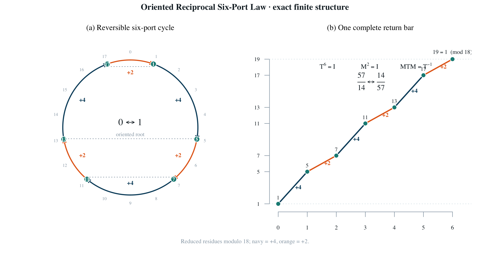
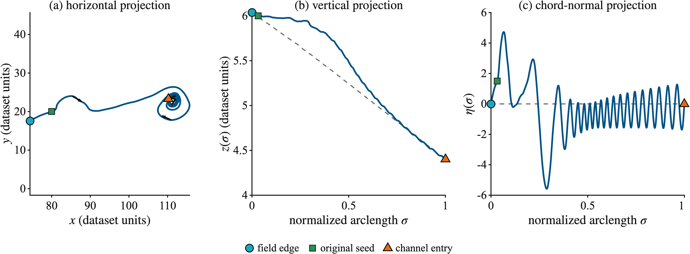

# Riemann Green Spiral

**An exact reversible six-port law with measured geometric and smooth fluid
branches.**

[](https://github.com/tmccoy678/riemann-green-spiral/actions/workflows/ci.yml)
[](https://doi.org/10.5281/zenodo.24413531)

## Oriented Reciprocal Six-Port Law

Let \(T\) advance through the ordered reduced residues
\(1,5,7,11,13,17\) modulo 18, and let \(M\) reverse the oriented root and
the three signed current coordinates. The law is

\[
T^6=I,\qquad M^2=I,\qquad MTM=T^{-1},
\qquad
\frac{57}{14}\longleftrightarrow\frac{14}{57}.
\]

The cyclic gap word is \((4,2)^3\). Its three `+2` crossings are
\(5\to7\), \(11\to13\), and \(17\to19\equiv1\pmod{18}\).
Dependency-free Lean proves the complete finite statement.



[Vector PDF](artifacts/Oriented_Reciprocal_Six_Port_Law.pdf) ·
[Lean boundary](Riemann/Mod18Boundary.lean) ·
[Lean return law](Riemann/OrientedSixPort.lean) ·
[R reproduction source](source/render_oriented_six_port.R)

| Branch | Finite object | Primary certificate |
|---|---|---|
| Arithmetic | Reversible six-cycle on the reduced residues modulo 18. | [`Riemann/OrientedSixPort.lean`](Riemann/OrientedSixPort.lean) |
| Measured geometry | Ordered Green Spiral trajectory with a certified finite return. | [`Riemann/Return.lean`](Riemann/Return.lean) |
| Smooth flow | Divergence-free unforced carrier with strict energy decay. | [`UNFORCED-NAVIER-STOKES.md`](UNFORCED-NAVIER-STOKES.md) |

## Finite return theorem

MATLAB's bundled `wind` field produces 49 streamlines from the declared seed
plane. Path 22 is the longest, with **2,677 ordered samples**. Its finite return
witness is:

```text
A  sample 1176  (110.196112, 23.287421, 4.400549)
B  sample 1336  (113.185550, 23.969641, 4.210346)
C  sample 1376  (110.067375, 23.297624, 4.170377)
```

Path 22 travels **3.072 units** from A to B and returns to within **0.264
units** of A at C, 200 samples after A. Lean 4.36 proves the ordering and both
quantized distance bounds. Python and dependency-free Rust bind those theorem
constants to the committed trajectory, field, neighborhood and mutation tests.

The original discovery animation is retained as experimental provenance:


## Ordered entry geometry

The backward-traced measured-field edge, original `(80,20,6)` seed and declared
channel entry define one ordered incoming segment

\[
\gamma:[0,L]\to\mathbb R^3,
\qquad \sigma=s/L.
\]

Its horizontal, vertical and endpoint-chord-normal projections reveal a broad
incoming counter-turn followed by increasingly rapid transverse oscillation
toward the recurrent channel. The plotted curve uses the exact ordered
coordinates without smoothing.



[Vector PDF](explorations/entry_wave/paper/Path22_Entry_Projections_Paper.pdf) ·
[SVG](explorations/entry_wave/paper/Path22_Entry_Projections_Paper.svg) ·
[coordinate definition and caption](explorations/entry_wave/paper/FIGURE_CAPTION.md) ·
[reproduction source](explorations/entry_wave/render_paper_figure.m)

## Verified results

| Layer | Verified finite result | Evidence |
|---|---|---|
| Renderer | Every visible point is a source sample; A, B and C fit one 220-sample rolling window. | [`Riemann/Renderer.lean`](Riemann/Renderer.lean) |
| Return | Excursion ≥3.0 units and return ≤0.3 units. | [`Riemann/Return.lean`](Riemann/Return.lean) |
| Channel | Three sampled returns, nonzero corridor velocity, finite field exit and unassigned exterior velocity. | [`Riemann/Channel.lean`](Riemann/Channel.lean) |
| Neighborhood | 313 sampled returns and 312 two-unit channel entries among 1,089 seeds. | [`data/path22_channel_receipt.txt`](data/path22_channel_receipt.txt) |
| Spectrum | Near-unit determinant, rotating-plane expansion, vertical contraction and 16 alternating Poincaré crossings. | [`Riemann/Spectrum.lean`](Riemann/Spectrum.lean) |
| Null atlas | 19 finite-field zeros, including 9 spiral zeros, remain distinct from Path 22. | [`Riemann/Nulls.lean`](Riemann/Nulls.lean) |
| Operator bridge | Critical-line/unit-circle arithmetic and a finite intertwining schema; the concrete arithmetic map is the open bridge theorem. | [`BRIDGE.md`](BRIDGE.md) |
| Oriented reciprocal six-port law | Six reduced residues modulo 18, exact `4,2,4,2,4,2` closure, three `+2` crossings, root mirroring, `T⁶ = I`, `M² = I`, `MTM = T⁻¹`, and exact `57/14 ↔ 14/57` reciprocity. | [`Riemann/Mod18Boundary.lean`](Riemann/Mod18Boundary.lean) · [`Riemann/OrientedSixPort.lean`](Riemann/OrientedSixPort.lean) |
| Maxwell realization | Source-free periodic field, measured focusing, caustic folds and convergent control tables. | [`PHOTON.md`](PHOTON.md) |
| Evanescence | MATLAB and COMSOL agree on one-sided decay, forward flow and diffusive Gaussian widening. | [`EVANESCENCE.md`](EVANESCENCE.md) |
| Unforced Navier–Stokes | Smooth divergence-free Path 22 carrier, zero body forcing, strict energy decay, local concentration, weak return and ARM/x86 reproduction. | [`UNFORCED-NAVIER-STOKES.md`](UNFORCED-NAVIER-STOKES.md) |

## Scope and literature position

Here **Riemann** names Path 22 and its certified finite return. The classical
Riemann Hypothesis concerns the nontrivial zeros of the zeta function in the
critical strip; NIST's DLMF gives the standard coordinate and Hardy-
\(Z\) formulation. The repository's number-theoretic theorem program seeks an
explicit map from the finite channel operator to an RH-equivalent arithmetic
operator. [DLMF §25.10](https://dlmf.nist.gov/25.10)

Recent Lagrangian–Eulerian learning reconstructs flow fields and long particle
trajectories jointly from sparse tracks, while memory-based reduced models learn
long-time Lagrangian statistics from short histories. This project addresses a
complementary finite question: preserve one observed ordered trajectory, test
its neighborhood and bind its return geometry to inspectable formal
certificates. [TrajectoryFlowNet](https://doi.org/10.1038/s42256-026-01316-7) ·
[data-driven Mori–Zwanzig model](https://arxiv.org/abs/2507.16058)

For the unforced Navier–Stokes carrier, universal all-initial-data regularity is
an open theorem. Rigorous a posteriori analysis supplies the appropriate route
from a controlled finite approximation to a strong-solution guarantee for a
specified initial field. [Chernyshenko–Constantin–Robinson–Titi](https://arxiv.org/abs/math/0607181)

## Computational scale

The verified v0.8.1 computational core at commit `62e3139` contained:

| Public quantity | Exact count |
|---|---:|
| Scientific source lines | 6,276 |
| Lean lines included above | 777 |
| Committed numerical TSV rows, excluding headers | 988,307 |

The experimental lineage preceding the MATLAB visualization comprised nine
complete adaptive Rust screens: **15,552,000 choices**, **38,621,335,765 audit
bytes** and **31.726 aggregate engine-minutes**. These screens informed the
field/current method and visual design. The finite return theorem is
reconstructed from the committed MATLAB trajectory and its Lean, Python and
Rust witness pipeline. The units describe different artifacts and are reported
without converting audit records into
"lines of proof."

For scale only, OpenAI's distinct forced-blowup Navier–Stokes project reported
approximately **10,000 concurrent agents**, **2.7 million messages**, **130
billion output tokens**, **88 hours** of discovery, and **17 additional hours**
of Lean formalization. Its public formal repository at commit
[`f9e8bc5`](https://github.com/openai/NavierStokesAndEuler/tree/f9e8bc5b38b6e212696e8a30e3e91517af887bbd)
contains **641,332 physical Lean lines across 2,659 Lean files**, compared with
this artifact's 777 Lean lines. These are repository/output scales, not measures
of theorem strength or efficiency; the mathematical statements are different.
[Official project report](https://openai.com/index/navier-stokes-solution/)

## Reproduction

```sh
lake build
lake exe riemann
cargo test --release --manifest-path rust/path22-audit/Cargo.toml
cargo test --release --manifest-path rust/evanescence-audit/Cargo.toml
shasum -a 256 -c MANIFEST.sha256
```

MATLAB R2026a regenerates the source streamlines and numerical analyses. COMSOL
Multiphysics 6.3 with LiveLink regenerates the evanescent–diffusive comparison.
External software and data provenance are recorded in
[`THIRD-PARTY-NOTICES.md`](THIRD-PARTY-NOTICES.md).

## Record and citation

- [Technical mathematical record](TECHNICAL-RECORD.md)
- [Mathematical lineage](REFERENCES.md)
- [Release checklist](PUBLICATION-CHECKLIST.md)
- Zenodo concept DOI: [`10.5281/zenodo.24413531`](https://doi.org/10.5281/zenodo.24413531)

Directed and authored by Taylor Westfall-McCoy with AI-assisted implementation
and verification. MIT licensed.
